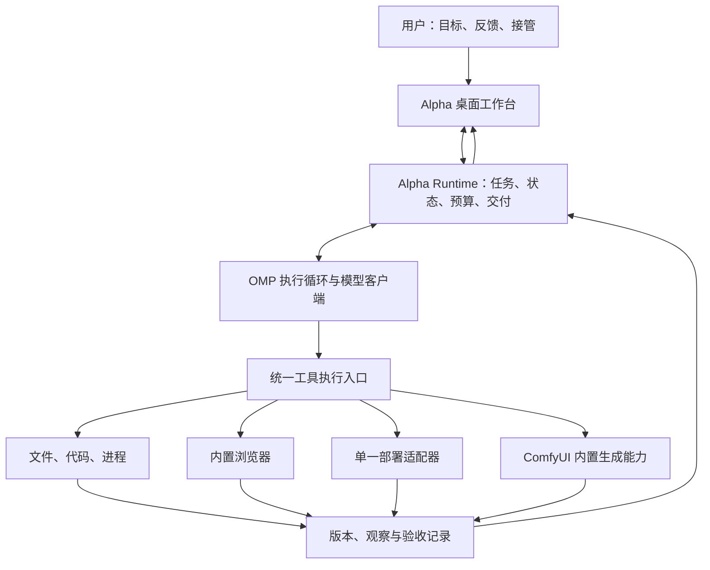

# Alpha：参考框架分析与施工计划

> 归档（2026-09-30）：本文记录已放弃或已被取代的旧架构与方案，不代表当前版本。当前方向见 [原生 OMP 重构](../2026-09-29-omp-native-refactor.md) 与 [定版收束建议](../2026-09-30-final-convergence-recommendations.md)。

日期：2026-09-24。状态：设计基线；本机首版施工与验收结果见 `implementation-status.md`。

编写本计划时仅阅读源码、核对公开技术文档，没有修改两个 reference 仓库、安装依赖、启动服务、执行模型任务或验证框架运行性能。以下原始框架分析中的“已实现”指在本地参考源码中找到实现；Alpha 后续实测结果另见验收记录。

用户已明确首版优先级：**软件产品——代码 + 界面验证 + 浏览器与部署**，并追加 **ComfyUI 作为内置多模态生成能力，需要生成时由 Alpha 主动调用，无需用户提醒工具名**。长期定位仍是 building agent；软件产品是第一条验收链，不是内核的永久能力边界。

补充只读检查：本轮 `server_info` 返回现有本地 ComfyUI 在线，地址为 `http://127.0.0.1:8188`，工作区为 `G:\comfyui\ComfyUI\ComfyUI`，GPU 为 RTX 5090。软件更新检查超时，不据此判断版本新旧。本轮没有执行生成或校验具体工作流；历史可用工作流在施工时仍须复核。

## 1. 核心判断

Alpha 值得做成一个有独立产品语义的构建工作台：模型可以决定如何推进，但目标、授权、资源、成果版本、验收状态和交付状态由运行时持有。

推荐组合方式：**完整继承 oh-my-pi 的核心编辑能力，尤其是 Hashline，并以其执行能力作为基础；吸收天枢将目标和证据外置的设计，由 Alpha 补齐“成果—版本—环境—验收—交付”这一层。** 保留一条模型执行循环，不把两套完整 agent loop、会话系统和提示词栈叠加。

Alpha 的完成条件应是：指定成果已经产生，适用的验收项有与当前版本对应的证据，交付入口可用；若目标包含部署，则对应部署实例也经过复验。单次工具成功、模型自述、测试通过、截图生成，各自只能证明其中一部分。

## 2. 分析基线

| 项目 | 本地版本信息 | 本轮确认的范围 |
|---|---|---|
| oh-my-pi | 相关包 18.2.11；Git `73a11421fe34fbab8ad058ab9c1a2e4f447852ea` | MIT；本地 Git 工作树干净；有通用 agent 包、多模型客户端、coding-agent 应用、浏览器、Windows 桌面实现 |
| Tianshu-harness | 3.25.0；Git `a6aeec3c06d56f1689c9404a307be739d7ae4aba` | Apache-2.0；本地 Git 工作树干净；有任务、验证、控制面与浏览器实现；本地没有 README 所述的完整 desktop 目录 |

这里以本地固定快照为准，没有将上游当前版本当成本地版本，也没有把 README 中的性能数字、测试徽章当作本轮实测结果。两份根 LICENSE 已读取；实际移植时还需核对所选依赖及第三方源码的许可证和 NOTICE，保留来源与修改记录。

## 3. oh-my-pi 的核心优点

### 3.1 把模型交互做成了可嵌入的执行引擎

`packages/ai`、`catalog`、`agent` 和 `coding-agent` 的分层，使模型协议、模型能力、执行循环和产品界面有可识别的接口。Agent 能处理流式输出、工具调用、事件、取消、steering 和 follow-up；`beforeToolCall`、`afterToolCall`、`onTurnEnd` 等接口为 Alpha 接入运行时控制提供位置。[O1][O2]

价值不只是支持多家模型，而是让“换模型、换界面、换任务”不必重写整条执行链。Alpha 应继承这些经过实际边界处理的机制。

但当前 `pi-agent-core` 并非一个无依赖的纯 JavaScript 小循环：它依赖 Bun、pi-natives、catalog、wire、snapcompact 等。不能按早期 Pi 的简洁印象估算移植成本，也不能直接在 Electron 的 Node 进程里假设兼容。[O1]

### 3.2 Hashline：首版明确直接复用的核心编辑能力

Hashline 是 Alpha 首版的必选项。它让模型用已观察文件中的定位信息和新内容表达修改，减少重复抄写旧代码与匹配失败；并把陈旧内容、未展示范围、操作顺序等问题交给编辑引擎处理。代码构建仍是 Alpha 的基础能力，应保留 OMP 在这一层的优势。[O10][O11]

**当前 reference 的实现已采用文件快照标签与行/语法块定位。** read 输出 `[PATH#TAG]` 加 `LINE:TEXT`，其中 TAG 是四位十六进制快照标记；edit 使用 `PUT`、`CUT`、`MV`、`REM` 等操作，并结合 EditStore 中的快照与已展示行记录。不能根据早期 Hashline 介绍，把当前实现简单描述为“给每一行加一个 hash”。[O10]

应当成套复用：读取/搜索输出格式 → 快照与已展示行登记 → 语法及提示词 → Rust pi-edit 引擎 → 预览与落盘 → 陈旧快照诊断/恢复 → 编辑后的新定位信息。只拿短 hash 算法或只改 edit schema，都会丢掉它最关键的上下游契约。

Alpha 首版将 Hashline 设为既有文本文件的默认局部编辑方式，新文件由 write 创建；跨文件符号重命名、引用更新优先使用 LSP；格式整理由项目 formatter 完成。整文件重写必须是任务需要，不能在锚点失败后自动退化成覆盖文件。短标签用于编辑定位，Alpha 的成果身份另使用完整内容指纹。

### 3.3 工具是有操作语义的工作面

读、搜、编辑和内部资源地址有较一致的使用方式；LSP、调试器、文件工具与持久脚本执行形成完整的工作链。它既减少重复描述工具的成本，也减少一次错误操作引发的重试。[O3]

对 Alpha 的启发：内核不应直接理解每一种专业软件，但工具接口必须返回可继续工作的对象和状态，例如一个浏览器 tab、一项运行中的服务、一份构建结果，而不是只返回一段“执行成功”。

### 3.4 已经具有超出终端编码的执行能力

持久 Python/JavaScript eval 可以调用工具；browser 支持独立 Chromium、CDP 和 relay；computer 有 Windows 原生截图、输入和 UI Automation 实现。它在工具能力上已经具备 building agent 的相当一部分基础。[O4][O5]

因此 Alpha 的差异不宜只定义成“增加浏览器与桌面工具”。更有价值的增量是把这些能力组织成可持续推进、可验收的产品工作流。

Windows desktop 仍需实机探针：源码包含对后台输入被部分 UI 框架丢弃的处理与说明。首版以受控浏览器为主，原生桌面放在后续明确需要时接入。

### 3.5 长任务具备可操纵性

会话、分支、steering、后台任务和结构化子代理，使用户能在任务运行中纠正方向、查看工作、保留上下文。结构化 worker 结果比纯自然语言“我做完了”更适合由上层接收和验收。[O6]

需要纠正两个容易误读的点：worktree 是代码工作区隔离，不等于桌面、网络或权限隔离；所检查的 task 执行路径中存在进程内执行，且部分子代理共享父 eval kernel，不能默认认为每个 worker 都拥有独立 OS 沙箱。[O6]

### 3.6 可扩展面较成熟

SDK、RPC、扩展、Skills、MCP 和事件接口提供了多种接入方式。Alpha 可以让既有工具继续发挥作用，而不从零维护模型协议、MCP 生命周期和所有文件操作细节。[O2][O7]

然而默认 SDK 的装配面较大，导入会牵涉 coding-agent 的配置、会话、工具与扩展。复用应锁定版本、收窄启用面，先验证再决定抽取范围。

## 4. 天枢的核心优点

### 4.1 将“该做什么”从聊天记录中外置

TaskContract 保存目标、约束、成功标准和状态；运行时不需要仅凭最后一条消息猜测任务是否仍然存在。这一点适合长时间构建：中间问一句状态、修改一处设计、压缩一次上下文，都不应让总目标丢失。[T1]

值得继承的是显式任务契约。现有字段和启发式仍偏代码任务，不能照搬文件路径正则与默认成功标准作为 Alpha 的产品需求理解器。

### 4.2 将“完成”与实际证据连接

DeliveryGateV2 综合任务账、文件归属、验证归因、当前 snapshotRef 等信息。它会区分自身改动失败、外部失败、未验证和旧快照证据；验证快照还能区分独立验证与合并后的验证。[T2][T3]

这里最有价值的是两个原则：**证据有适用对象和版本；局部成功不自动等于集成成功。** 对 Alpha 而言，这应延伸到构建产物、页面实例和部署实例。

当前门禁仍明显依赖 owned files 和测试；没有 owned files 时可以 GREEN。浏览器完成一项任务却没有修改文件，不能因此被 Alpha 自动判断为成功。[T2]

### 4.3 运行时能够独立观察、纠偏和停止

RuntimeHookPipeline 具有五个阶段，记录 hook 成败、耗时和超时。ControlPlane 是确定性 reducer，将事实分别送往日志、界面、上下文附录和需决策的通道，避免每个机制都直接向模型倾倒提示。[T4][T5]

这比“增加一大段 system prompt”更适合做长任务运行时。但 Alpha 不应照搬全部 hook、星域名称、认知指标和相互依赖。先实现少量与可观测失败直接对应的规则，并让每条规则有反例测试。

普通观测 hook 的异常可以记录后继续；关键权限、交付门禁需要明确的执行语义。不能把一个带超时后继续运行的观测管线直接当作必定阻断动作的授权系统。[T4]

### 4.4 上下文成本和稳定性被当成工程问题

PromptEngine 对稳定部分、冻结上下文和动态 appendix 作区分，按边界更新，尽量减少前缀扰动。核心思想是按变化频率组织上下文，而非每轮重新拼装一切。[T6]

Alpha 应吸收这种组织方式，并计量完整任务成本。README 的 98–99% 缓存命中率不是 Alpha 的可继承保证；其结果依赖提供商、模型、请求形态与任务，需在 Alpha 场景中复测。

### 4.5 编排服务于交付，而不是仅增加人数

类型化 work order、分波执行、文件归属和验证归因，为协作提供了约束。Alpha 应继承“明确工单—限定范围—返回证据—集成后复验”的链条。

星域的工程价值主要在于任务相关提示词、工具面与策略可以改变。Alpha 首版适合把这种机制表达为普通的任务阶段和能力配置，避免先引入大量角色体系。

### 4.6 产品检查已有值得借鉴的工具

`browser-debug` 有持久浏览器、CDP、console、network、viewport 和交互；design 插件有截图、像素差异与响应式检查。它们比简单的截图工具更接近软件产品验收。[T7]

但视觉提醒仍有按工具名识别“看过界面”的局限。Alpha 需要记录具体观察、交互和判断，不能把“调用过 browser_debug”作为视觉验收通过。[T8]

## 5. 不能直接搬走的部分

| 发现 | 对 Alpha 的影响 |
|---|---|
| 天枢 computer-use 执行实现迁入不在公开仓的 `src/pro`；本地无完整 desktop | 不能把完整天枢桌面端和 native computer 计入现成可复用资产。[T9] |
| 两份框架的所检查 artifact 模块主要服务于工具大输出与会话存储 | 可以用于日志和 blob，Alpha 仍需新增成果版本、验收与交付记录。[O8][T10] |
| 天枢插件 permissions 只是 advisory | manifest 声明不构成隔离；首版只接受明确选择的内置或可信工具。[T11] |
| OMP SDK、Bun 和 Rust native 依赖较重 | 将 OMP 放进独立 Bun sidecar；P0 做 Windows 安装和打包探针，不承诺直接运行于 Node。[O1][O7] |
| 工具重试可能重新触发外部动作 | 发布、提交表单等动作必须记录请求标识和实际远端状态；响应丢失时先对账，不盲重试。[O9] |
| 多代理共享机器上的浏览器、端口、进程与凭据 | 除 worktree 外，还需要资源归属和单写者规则。[O6] |
| 缓存、hook 数量和 benchmark 胜率来自不同证据范围 | 只在相同 Alpha 任务、模型、预算下比较，不能推导两者组合必然更强。 |

## 6. 产品定义与首版范围

建议的定位：**Alpha 是在用户可见的工作空间里，持续把目标变成经过验证的可用产品的智能体。**

用户的主要对象是“我要做的产品”“正在看的版本”“尚未满足的要求”，而不是必须先学习工具命令、agent 角色或 Git 术语。对话负责表达意图；工作台负责展示实际对象和状态。

首版产品形态建议：Windows 优先、本地运行、桌面工作台。具备项目与任务列表、对话、实时应用预览、运行状态、关键证据与交付入口；可展开查看 diff、终端和详细日志。用户能随时停止、修正目标、接管浏览器，然后把操作权交还 Alpha。

首版必须做到：

1. 使用一个固定 Web 产品模板，将简短需求构建为可运行应用。
2. 启动并管理应用进程，识别就绪、启动失败、端口冲突和服务退出。
3. 在内置浏览器真实执行关键用户路径，检查页面、console 和请求结果。
4. 失败时根据当前证据修复，并重跑受影响验收。
5. 部署到一个明确指定的预览环境，拿到真实部署标识与 URL。
6. 打开部署后的实例，确认版本与关键路径，再给出交付结果。
7. 运行中可取消、可恢复；预算到达上限时保留现场并准确报告。
8. 产品需要原创图片、视频或语音等素材时，主动使用已配置且可用的 ComfyUI 工作流生成，检查后接入项目，并在实际产品中复验。

首版暂缓：原生任意软件全自动操作、完整文档/长篇影音项目编排、3D/Game 全流程、跨云部署平台、插件市场、自动经营账号、无人值守生产迁移、长期自我修改与复杂角色社会。ComfyUI 的基础素材生成已纳入首版，不属于此处暂缓的完整创作系统。

首个模板建议是带简单真实数据持久化的 Web 小产品。模板选择用于控制第一轮验证变量，不成为 Alpha 内核限制。用户已选定首版部署目标为**本机当前项目目录**，只需本地测试，不接外部平台；本地预览仍应有可追溯的构建版本、受管理进程和真实浏览器复验。

## 7. 架构与复用路线

### 7.1 复用方式的取舍

| 路线 | 好处 | 主要代价 | 决策 |
|---|---|---|---|
| Fork 天枢并接 OMP 工具 | 任务/验证体系现成 | 主循环与产品语义耦合较深；公开桌面能力不完整；工具层适配两套宿主 | 不作为首选 |
| 将两套完整 agent 当上下级运行 | 可以较快演示委派 | 重复计划、上下文、预算和终止判断；很难定位谁决定完成 | 不采用为正式架构 |
| Alpha 自己管理任务与交付，OMP 提供唯一执行循环 | 保留成熟执行能力；产品语义清晰；天枢机制可逐项移植 | 需要新增成果/验收模型，验证 SDK 和工具接缝 | 推荐 |
| 全部从零重写 | 任意控制 | 浪费现成协议、工具和恢复细节；首版风险最大 | 不采用 |

实现时将 OMP 依赖集中在一个 engine 模块。**首选在 Bun sidecar 中使用受限的 `createAgentSession` SDK 组合**，以保留完整 Hashline、read/search、会话与浏览器工具，减少拆分和重写。若裁剪后仍不能满足 Alpha 的控制要求，才评估 `pi-agent-core` 配合工具适配的备选方案；不以包名“core”判定轻量。

本快照 SDK 可显式覆盖 systemPrompt，使用 `toolNames`、`restrictToolNames` 和 `allowRestrictedCustomTools` 约束工具，关闭自动扩展发现，并对 skills/rules/contextFiles 等传明确装配结果。受限模式会关闭内置 MCP 与 memory；因此需要的 MCP 必须经 Alpha 的受控工具适配接入，不能一面声明完全受限，一面依赖默认自动发现。具体选项在 P0 以锁定版本的行为探针核实。[O7]

还有一个装配细节：受限模式不会直接加载普通 `extensions` 列表，需要正确预加载/绑定 prepared extensions，或把必要控制放在受控工具适配入口。单个 `beforeToolCall` 也不代表所有内部动作都已覆盖：eval 重入、browser/computer prelude、worker 和原生工具委托有不同路径。P0 必须逐项记录执行路径；不能用“加了一个 hook”宣称取得完整控制。[O13]

P0 装配必须同时满足：普通工具、eval 内工具和 worker 调用具有所需调用归属与控制；取消后不再派发新动作；恢复后调用、版本、证据仍能关联；Hashline 全链与用户可见的同一浏览器 tab 可运行；默认 advisor、自动发现等未经选择的行为不产生额外调用。未启用的入口先保持关闭。满足条件时选改动面最小者；任一项失败要列出最小补丁和成本，不把“能启动”作为通过。

正式应用只保留一种装配，不在生产中同时维护两条引擎路线。默认优先保留 OMP 已有工具能力；若 SDK 的隐式行为不能可靠关闭或管理，才下沉到 core。任何深层移植都要记录来源和本地差异，避免上游升级覆盖 Alpha 的语义。

这项装配选择有一条明确约束：**无论采用 SDK 还是 core，必须保留同一版本的完整 Hashline 链路。** 不能为了减小依赖而把它换成普通字符串替换。如果选择 core 后需要大量重做 read/EditStore/native edit，优先评估保留 SDK 的实际成本。

### 7.2 技术载体

建议 Electron + React 承载工作台与内置浏览器，OMP 运行在独立 Bun sidecar。这样不用先把 OMP 改造成 Node 库，也不需要重做 Chromium 工作面。Electron 主进程负责窗口、浏览器实例和少量系统能力；前端 renderer 不直接拿工具执行权限。

工作台与 sidecar 先用有版本的本地双向消息协议连接，可采用 stdin/stdout 的请求、响应和事件帧，日志走独立通道。先不引入远程控制服务、微服务或多机调度。

开发顺序建议：公共运行时先行，复用 OMP TUI 做最小执行与恢复验证，同时探通桌面薄壳；第一条执行链稳定后，以桌面产品闭环为主线。TUI 与桌面使用相同命令/事件和任务状态，不等待完整 TUI 产品再做桌面，也不在初期同时打磨两套完整界面。ComfyUI 作业同样属于公共运行时，两端都可使用，桌面负责丰富预览。

Electron 当前有 WebContentsView 可展示并管理 WebContents；BrowserView 已标记废弃，应使用当前接口。[W1] 浏览器中的产品页面与 Alpha 自身 UI 隔离，远程内容关闭 Node integration、开启 context isolation 和 sandbox，IPC 只接受明确来源和结构化参数。[W2]

P0 需证明 WebContentsView 与 OMP 浏览器驱动指向同一个页面实例：用户看见操作、手动更改状态后 Alpha 能重新观察，不能让驱动另开隐藏 Chromium，再将其截图当作内置浏览器状态。若采用 CDP，限制其监听面并由宿主管理连接生命周期；具体桥接以该贯通探针通过为准。

Tauri + sidecar 也具有官方支持。[W3] 本次更倾向 Electron，是因为内置 Chromium、浏览器调试与用户接管是首版核心；这一选择承担更大的安装体积与内存成本。P0 若 Windows 打包、CDP 或内存实测不满足预算，再依据证据调整，不因天枢使用 Tauri 就直接照搬。

### 7.3 模块职责

| 模块 | 持有的职责 | 明确不持有的职责 |
|---|---|---|
| Engine | 模型请求、流、工具循环、取消、steering、provider 状态 | 最终产品是否完成 |
| Task Runtime | 目标、约束、任务状态、计划修订、预算、恢复、结束条件 | 浏览器底层实现、云厂商协议 |
| Tool Execution | 调用身份、参数校验、权限范围、资源锁、超时、执行回执 | 自己判断整个任务完成 |
| Workspace / Browser / Deployment / ComfyUI adapters | 操作实际对象并返回可验证结果，管理长任务回执 | 自行扩大范围或选择新服务替换用户指定服务 |
| Evidence & Delivery | 版本、验收项、观察记录、验证结果、交付记录 | 用模型自述伪造工具证据 |
| Workbench | 用户可见状态、预览、反馈、接管和交付入口 | 另一套独立任务状态机 |

目录只需先分 `apps/desktop`、`packages/runtime`、`packages/contracts` 和 `tests/scenarios`。runtime 内部按上述职责组织；除引擎与实际变化的适配器外，先不拆成多个独立发布的包。只有遇到第二个真实实现时，才抽取更通用的接口。

### 7.4 Hashline 移植施工单

| 工作 | 直接复用内容 | Alpha 需要接上的部分 |
|---|---|---|
| 统一读取与编辑定位 | OMP read/search 的文件标签、行号和 EditStore 登记 | 工作区真实路径、session/worker 归属；不能只在 UI 显示标签却不登记到编辑引擎 |
| 保留编辑语言与执行器 | `crates/pi-edit` 的 Hashline parser、patcher、块解析、预览和恢复；同版 prompt/schema/native bindings | 将工具事件和最终变更交给 Alpha 任务记录，避免独立实现另一套兼容方言 |
| 陈旧内容处理 | 引擎当前的快照检查、诊断和受约束恢复 | 记录恢复发生及实际落点；无法明确恢复时重新读取；人工接管/外部修改后刷新观察 |
| 写后关联 | 编辑结果和 diff、新快照 | 更新 BuildRevision，使旧验证失效；触发适用的 LSP 诊断和验收 |
| 并发与恢复 | 保留上游引擎原有行为与测试样例 | 同一文件的写操作串行；会话恢复后重新建立必要读取记录；不把短标签或 worktree 当成锁 |

Hashline 本快照的四位 TAG 是规范化内容的截短 xxHash；它不是防碰撞摘要。引擎先对目标文件 stage，校验失败可在写入前结束，但真正提交逐文件进行，后续 writer 失败不会回滚已经写入的文件。因此不能宣传为多文件事务。[O12]

Alpha 的 host writer 另做最小补强：管理自身文件写入归属；在准备写入时重新核对完整内容指纹；使用可验证的单文件暂存/替换写入；对批量操作逐项记下已提交和失败项。外部编辑器可能不参与 Alpha 的锁，完整指纹复核也不能被宣传为跨进程绝对无竞态；必要时停止并重新读取。故障后保留部分结果与恢复依据，不盲目回滚可能混有用户改动的文件。Hashline parser、定位与恢复策略继续沿用上游。

验收至少包含：精确单行替换；非相邻多段编辑仍使用原始行号；局部读取后尝试编辑未展示范围；旧快照下原位置改变；重复代码导致恢复歧义；中文/emoji/CRLF/BOM/末尾换行；语法块含装饰器/注释；编辑失败时原文件状态；人或另一 worker 同时修改；重启后旧定位记录；编辑后实际产品测试与界面行为。每项预期以所选上游契约为基线，再为 Alpha 的任务和版本关联增加验收。

P0 跑通读取→修改→陈旧定位处理的最小链，P1 接入正常构建，P2 将变更与验收新鲜度关联，P5 验证多 worker 下的资源归属。这样 Hashline 从第一轮可用产品开始就是默认能力，而不是后期优化。

### 7.5 ComfyUI：主动使用的内置多模态生成能力

产品决策：Alpha 面向用户个人使用，默认知道用户已有的 ComfyUI 服务、常用工作流与质量偏好。在任务需要生成素材时主动选用，不要求用户说出 ComfyUI、模型名或 workflow 文件名。此处“内置”指随 Alpha 默认装配并参与规划的能力；执行后端沿用现有 ComfyUI 安装，不搬迁模型、不重装整套环境。

这项能力也直接服务于“做一张图”“把参考图变成短视频”“给这段文字配音”等独立任务，不要求先建立软件项目。ComfyUI 负责生成，主模型或实际可用的媒体理解工具负责查看、试听与判断；两者分别探测可用性。

**最小实现为一个内置 ComfyUI adapter，加一小份经验证的工作流配置。** 优先复用现有 comfy-local MCP 的能力探测、工作流参数检查、验证、异步提交、作业跟踪与输出获取。Alpha 必须拥有自己的连接配置和作业映射；当前 Codex 可调用 MCP 不等于未来独立 Alpha 已自动获得连接。只使用现有安装，不做插件市场或新的节点编辑器。

每个工作流配置记录用途、输入输出类型、实际 workflow 路径和指纹、允许修改的参数槽、模型/节点依赖、适用质量范围、默认参数与运行预算。模型看到“生成页面插画”“参考图生成短视频”“生成配音”等能力描述，适配器负责实际节点映射。缺少注册且已验证的工作流时标记该能力待配置，不能虚报支持所有模态。

**主动调用发生在任务需要素材时。** 任务规划应识别素材用途、已有输入、尺寸/时长、风格与交付位置；有匹配的现成素材时可复用，需要原创或修改时调用生成。用户只说“做一个有原创插画的页面”，就足以触发生成；用户明确说“只用现有素材”“保留原图”或“只分析”时不能触发。仅提到图片/视频不是运行信号，也不为了展示能力给纯逻辑修复生成装饰图。

完整执行链为：识别素材需求 → 选择个人默认工作流 → 在副本中填入参考素材、提示词和允许参数 → 验证 → 提交并记录 prompt/job ID → 跟踪进度 → 检查结果 → 接入项目 → 在浏览器中复验。运行过程只需自然告知正在做什么，不逐次询问是否使用 ComfyUI。常规本地生成在任务授权和预先设定的预算内自动进行。

原生输出留在 ComfyUI 的输出位置；工程需要素材时，复制被采用的版本到该项目明确的素材路径，并记录原始来源。保留源 workflow、生成副本、输入指纹、有效参数、seed、模型/工作流版本、job ID、输出指纹和采用关系。这里是项目交付资产，不建立或重排全局媒体库。

此前已约定的视频默认是 MiniMax H3 Ref2VA 八步、1.0M、FlashVSR 2×；历史记录另有 VoxCPM2 配音/声音克隆工作流。这些作为个人配置迁入的候选基线，本轮未重新校验其当前文件、节点和生成质量。施工时检查实际配置，保留已批准的默认链与参数，不因省时自动降低分辨率或改步数；具体图像默认工作流尚需通过现有工作流配置确认。

长生成采用异步作业；等待期间 Alpha 可以继续无依赖的代码工作。一个 GPU 上的重任务初始按单并发处理，尊重已有队列。取消只针对本任务拥有的作业；服务的中断接口若作用于全局正在运行的任务，先核实当前归属，不能为取消自己的任务误停用户其他生成。提交响应丢失时先用可核对的作业记录查询，无法确认就保持结果未知，避免重复耗算力。

素材生成后至少检查格式可读、尺寸/时长、内容是否满足用途；图像要查看，视频要检查时间连续性，音频需实际试听或明确尚未试听。视觉/听觉验收能力不足时不能声称已完成该项检查。采用素材后使对应 BuildRevision 更新，重新检查页面裁切、加载、播放与性能。需求已经改变时，迟到结果保留为旧候选，不自动覆盖新页面。

普通本地调用不需要逐次批准；安装/更新模型节点、改变既定服务、付费节点和启动/停止 ComfyUI 不从“主动生成”中自动推导授权。能力可用性和预算一次配置、持续生效；服务离线或资源不足时准确告知并继续独立工作，不自行切换到网上的另一个生成服务，也不默默降低质量。

首版验收包括：不点名工具但需要原创插画时自动调用；已有合适素材时不重复生成；明确禁止生成时零提交；生成成功后真正接入并检查页面；需求变更后迟到结果不覆盖；断线恢复不重复提交；GPU 忙时不误停他人任务；服务离线时不伪报完成或换服务。图片、视频、语音配置分别验证，能力面只公布通过的项目。

## 8. Alpha 必须新增的最小状态模型

无需先造知识图谱或完整工作流语言。首版围绕六类记录即可：

| 记录 | 最少内容 | 解决的问题 |
|---|---|---|
| TaskContract | 目标、范围、约束、验收项、已授权目标与动作、预算、版本号 | 任务不会被局部对话覆盖；修改目标可追踪 |
| BuildRevision | 源码快照、dirty diff/相关文件内容指纹、依赖锁定、采用素材版本、构建产物指纹 | 知道测试和部署针对哪一版；不要求先 commit 才能验证 |
| ActionAttempt | 调用 ID、输入、资源、授权引用、执行状态、外部请求标识；生成任务包含 workflow/输入指纹、参数和 job ID | 中断/超时后能确认动作是否已经发生 |
| Observation | 工具来源、时间、页面/环境、截图或日志引用、内容指纹 | 保留真实观察，避免只存模型总结 |
| Validation | 验收项及其修订号、BuildRevision、实际运行实例、环境/fixture、检查器、结果、证据引用 | 判定当前版本在当前要求下有哪些条件已得到证明 |
| Delivery | 构建产物、部署 ID、URL、目标环境、线上复验、遗留项 | 交付对象和状态明确，可复查 |

验证结果至少包含通过、失败、未执行、不适用；不适用必须有理由，不能用于绕过必要条件。观察存在、模型判断通过、确定性断言通过、用户认可，是不同来源，不应压成一个模糊的“已验证”。

本地任务与上述记录可使用一份 SQLite 数据库，关键状态变更和对应事件在同一事务写入。大日志、截图与构建产物放文件存储，由指纹关联。OMP transcript 负责对话历史，Alpha 数据库负责产品任务事实；一个事实不能由两套系统分别改写。数据库启用合适的持久化配置，关键外部动作先落账再发出；不能将“存在日志文件”视为断电恢复保证。

代码、配置、依赖或部署环境变化后，受影响的旧验证变为过期。首版可以保守地使整项构建的验证失效，待有实际成本压力再做精细影响分析。不能为了节省验证成本而冒用旧截图。

需求或验收定义改变时，即使代码未改，也要重新判断旧证据适用性。验证前核对页面实际加载版本及服务实例，避免 localhost 地址没变但 dev server/HMR/缓存仍是旧版本；第一种受控产品模板应提供可查询的版本标识。外部已有应用不能取得强版本标识时，明确记录可确认的范围，不制造同版本证明。

## 9. 主循环、纠偏与完成条件

建议执行语义：理解当前目标 → 建立/更新验收项 → 选择最小可推进动作 → 执行 → 收集观察 → 更新成果与验收状态 → 决定继续、修正、等待或交付。

这是一条 OMP loop 上的运行时规则，不额外启动一个常驻“总指挥模型”复述所有工作。模型提供计划与判断，确定性逻辑负责版本匹配、预算、授权和状态合法性；视觉与产品质量等开放判断保留不确定性，运行时不能凭规则证明任意产品正确。

首版保留五类控制：

1. **目标保持**：新消息默认作为当前任务修订或追问；只有明确的新目标才替换任务。收缩验收范围不能悄悄发生。
2. **动作约束**：调用前校验范围、可用性、资源和预算；调用后写入回执。Skills 与网页内容提供信息，不能直接获得用户授权等级。
3. **验证新鲜度**：修改版本使旧证据过期；子代理报告必须引用可读取证据，由主任务核对。
4. **停滞与预算**：同类错误反复且无新证据时调整策略；达到硬预算或确认无法推进时保留现场、报告阻塞。次数阈值作为初始配置，靠验收任务校准。
5. **交付检查**：只在必要验收项得到当前版本证据时标记相应交付状态；缺项可交付“部分成果”，但不能同时标记任务完成。

“准备好交付”“预览环境已部署并复验”“用户认可设计”“生产已发布”分开记录。用户已授权的范围内连续执行；真正跨出范围时才请求决策，不能在每次普通编辑或测试前增加确认。

## 10. 浏览器、进程与部署的工作方式

### 10.1 浏览器是持久工作对象

每个项目拥有明确的浏览器 session，tab 有 ID、当前 URL、观察版本和操作归属。优先使用 DOM/AX/可访问名称完成定位与交互，截图用于观察布局与视觉问题，坐标操作只在确实必要时使用。

一次只允许一个主体操作同一 tab。用户接管时停止新派发、清除未执行动作队列、撤销当前操作权，并在有界时间内中断可取消的长动作；不能无限等待一个多步 browser run。迟到回执只用于记录已发生的结果，不能触发下一步操作。交回时重新观察。导航、重渲染或用户操作后，旧元素引用要重新验证。P0/P3 包含“多步操作中途接管—人工更改页面—交回”的完整验收。

登录和需要人工参与的步骤可以由用户在内置浏览器完成。Alpha 保留进度，随后继续；cookie 和登录态不应作为普通消息内容传给模型。用户指定的浏览器或服务不可用时，明确报告并保留任务，不自动替换成别的在线流程。

### 10.2 运行中的产品需要受管理

dev server 记录 PID/子进程关系、cwd、端口、日志、健康探针、创建者和停止句柄。端口冲突时辨认进程归属，不能直接杀占用端口的用户进程。停止任务应停止它自己的工作，用户已有进程按既有授权处理。

单元测试、构建和浏览器检查消费相同 revision。依赖安装、运行产品代码和任意 shell 具有更宽权限，工具白名单或 worktree 不能被描述为 OS 沙箱；首版明确项目可信度、最小进程环境和凭据传递范围，需要强隔离的任务另行选择实际隔离执行器。

### 10.3 部署是独立动作与验证阶段

首版只支持一个选定目标：本机当前项目目录。部署适配器将经验证的构建产物放入该目录下的版本化预览位置，启动受管理的 loopback 服务，并返回实际的预览 ID、路径和 URL，不让模型猜测 URL。

发布前冻结 BuildRevision；发布后记录 preview ID、实际 URL、源码/构建标识及本机进程。对最终预览实例复验，而不是把开发服务上的旧页面当作新版本。

启动超时可能表示回执丢失而本机服务已就绪。状态先记为“结果待确认”，查询本机受管理进程、端口与预览元数据后再决定重试。取消等待不等于服务已停止；必须记录后来返回的结果。回滚仅处理 Alpha 自己创建的预览版本。

查询需要真实关联依据：本地预览元数据写入任务 ID、构建指纹、预览 ID、服务 PID 和端口。响应丢失时按这些字段对账；无法唯一确认就保留未知状态，不自动重启或占用用户已有端口。

默认的软件产品验收目标是本机预览环境。生产域名、外部平台或收费资源不在首版验收范围。

## 11. 多代理与上下文策略

单代理闭环稳定后，再引入一个协调者与少量 worker。初始并发上限可设为 2 个 worker，避免在没有收益证据前增加模型调用和共享资源竞争。

工单包含目标、输入 revision、允许范围、交付对象、验收要求、预算和禁止并发操作的资源。worker 返回成果引用、证据和未解决项，而不是只返回文本摘要。独立代码修改可用 worktree；整合后仍在目标 revision 上重跑集成与浏览器关键路径。

浏览器 tab、桌面窗口、输出目录、服务端口和部署目标采用显式归属或短期资源锁；Git worktree 只解决文件层面的一部分问题。

上下文按稳定规则、项目事实、当前任务状态、近期观察分层。稳定工具定义和规则尽量固定；动态状态增量进入尾部；原始工具输出保留引用、按需展开。工具发现可渐进加载，但不能为了维持缓存而忽略失效能力或新的用户约束。

压缩前后校验：目标、验收项、用户授权、未完成动作、成果版本和预算不丢失。不要让 OMP 与 Alpha 同时各自压缩同一份历史：由一个上下文管理入口负责，Alpha 状态可重新注入。

跨会话记忆先只保存带来源和适用范围的稳定项目事实、明确偏好及已验证经验，不自动把一次猜测变成永久规则。首版不增加第二套向量数据库或“自动自我进化”流程。

## 12. 施工阶段与退出标准

下面为一名熟悉 TypeScript 的工程师、使用 agent 辅助时的粗略人日预算，不是已经验证的交期。首条闭环先跑通，再扩功能。每阶段达标后再进入依赖它的阶段。

| 阶段 | 工作与产物 | 验收/退出标准 | 估算 |
|---|---|---|---|
| P0：冻结基线与技术探针 | 来源/许可证清单；OMP 装配决策；Windows Bun/native 打包探针；Hashline 完整链探针；模型/浏览器/部署目标探测；ComfyUI 默认工作流与连接配置；固定首个产品模板和任务集 | 不改 reference；能受控调用模型、取消、执行 Hashline 读改及陈旧定位处理、浏览器截图与交互；确认 ComfyUI 可用与待配置能力；选择唯一引擎装配 | 2–3 人日 |
| P1：最小工作台与真实构建链 | Electron/React 薄界面、Bun sidecar、消息协议；Hashline 默认编辑与文件/进程工具；内置浏览器；第一版可运行产品 | 输入 brief 后产出应用，使用 Hashline 修改已有文件，启动并真实点击核心路径；运行中 UI 不阻塞；可停止且不留本任务孤儿进程 | 5–7 人日 |
| P1.5：ComfyUI 生成接入 | 内置 adapter、个人工作流配置、主动素材规划、异步作业与GPU归属、结果预览及项目引用；先贯通一个图像任务，再逐项验证既有视频/语音工作流 | 用户不点名工具也会按需求生成并用进产品；遵守不生成要求；取消/断线不误停他人或重复提交；只暴露已验证能力 | 增量 4–7 人日，假设工作流/模型已就绪；否则 P0 重估 |
| P2：任务与证据状态 | 六类最小记录、版本指纹、验收状态、统一工具回执、预算、恢复、明确交付状态 | 旧证据不能验证新代码；未验证不得完成；在写入、测试、工具返回边界强制中断后可恢复；不重复不明结果的外部动作 | 4–6 人日 |
| P3：产品界面闭环 | 浏览器用户路径、响应式检查、console/network、人工接管；失败→修复→复验；证据面板 | 预置的窄屏遮挡、保存失败假成功都能被发现；修复后按同一 fixture 复验；截图本身无法满足交互验收 | 4–6 人日 |
| P4：本机预览部署闭环 | 版本化本机构建、受管理 loopback 服务、启动回执、版本关联、进程/端口查询、独立浏览器复验 | 提供真实 preview ID、路径与 URL；在新实例跑过关键路径；模拟响应丢失先查询后处理；不干扰用户已有进程 | 3–5 人日 |
| P5：受控并行与长会话 | 少量 worker、工单、资源归属、合并复验、单一上下文管理、使用量统计 | 两 worker 不同时写同一资源；合并后问题不会被各自成功掩盖；压缩/恢复保留目标与授权；对比单代理收益 | 4–6 人日 |
| P6：本机发布质量与实际试用 | 当前项目内可携带发布目录、升级/回退、诊断、断网/重启/权限不足/端口冲突处理；固定场景重复评估 | 在本机从发布目录独立启动并完成三条端到端任务；新旧版本读取同一项目数据，提交全部失败记录和已知限制 | 2–4 人日 |

当前本机发布范围的软件闭环粗估约 24–37 人日；纳入现有 ComfyUI 的有限工作流接入后约 28–44 人日，P0–P4 含 P1.5 约 22–34 人日。这是设计时的人日估算，不是已用工时或剩余工期。该增量不包含新模型/节点部署、工作流研发或新的音视频理解后端。若 P0 发现需要大规模拆解 OMP、重建浏览器桥或处理部署限制，应据实重估，不能靠减少界面验证把进度伪装成达标。

依赖顺序：P0 → P1 → P2 → P3 → P4；P1.5 的连接与工作流探针可提前并行，作业/素材与 P2 记录共同收口，在 P3 验证实际页面集成；P5 在单代理产品闭环稳定后开展；P6 收口全部选定能力。可并行的工作包括：固定验收样例、薄 UI、证据 schema 和部署 API 探针；共享内核和浏览器状态管理不适合多人无界同时改动。

每阶段只要求与实际变化相称的测试：状态机和故障恢复用确定性测试，浏览器/部署用集成测试，模型行为用端到端任务。不能以大量 mock 测试替代实际浏览器或部署验证。

## 13. 首版三个端到端验收任务

### A. 从需求构建一个可用小产品

示例：素材清单应用，可新增、编辑、分类筛选与持久化。验收数据、文案、桌面/窄屏两种 viewport 在任务开始前固定。

必须交付源码、可运行构建、实际预览入口和验收证据。Alpha 在浏览器新增记录、修改、筛选并刷新页面，确认数据仍在；检查空状态、非法输入和窄屏布局。生成一张页面、只用静态假数据或只跑单元测试，均不能通过这项任务。

追加 ComfyUI 验收变体：需求只写“为页面设计一幅原创主题插画”，不出现 ComfyUI 或工具名。Alpha 应自动生成、查看并采用素材，在页面中检查裁切和加载；对照输入“只用已有素材，不生成新图”时不得提交生成任务。视频/配音用独立模态用例验证，不能用图片成功代替。

### B. 修复只在真实使用中出现的问题

在同类产品中预置两个故障：窄屏下提交按钮被遮挡；保存 API 失败但界面仍提示成功。Alpha 必须先获取失败证据，修复后在相同 viewport 与 fixture 重跑，确认请求结果和页面结果一致。

途中改变用户要求或重启一次会话，检验它是否保留原目标与未通过项。编译成功、看过截图、重复使用修复前证据均不能通过。

### C. 部署已验收版本并复验

将 A 的指定版本部署到当前项目目录下的本机预览目标。必须拿到 preview ID、实际路径和 URL、版本关联，并从新的浏览器会话执行关键路径。

注入一次启动回执超时/响应丢失或受控发布失败，确认 Alpha 会查询进程、端口与预览元数据，再决定继续、重试或恢复。只看到进程启动，或打开的其实是旧实例，均不能通过。

每个任务至少一条正常路径、一条受控故障/恢复路径。真实模型评估初步采用每项 3 次固定配置重复，共 9 次正常任务运行，另跑确定性故障用例；样本只用于早期工程判断，不能宣称广泛泛化能力。

## 14. 如何判断组合是否真的有价值

对同一模型、同一任务输入、同一环境和预算，比较：OMP 基线、Alpha 仅执行层、Alpha 加任务/证据层；待并行能力加入后，再做单代理与多代理对照。天枢若在当前环境成功运行，可追加同等工具权限与预算的参考组；不能把缺失能力的失败直接归因于模型或框架设计。

记录至少六类结果：

- 任务成功率：预先定义的验收项与指定交付入口均满足。
- 错误完成声明：系统标记完成，但实际有必需项失败或未验证。
- 人工介入：区分事先约定的登录/审美审阅与非预期救援。
- 恢复正确性：中断后不丢任务、不重复未知副作用、不冒用旧证据。
- 总成本与耗时：包括所有 worker、失败重试、压缩、审查和最终复验。
- 用户可检查性：能够定位失败在哪一步、依据哪一版证据，以及怎样继续。

发布门槛首先是关键负向测试全部通过，固定任务集中没有错误完成声明；缓存命中率和并发加速属于后续优化指标。小样本观测到零错误不能被写成“保证从不虚报”。

Hashline 单独记录编辑首次成功率、错误落点、修复后任务成功率、重试次数与总 token。需要评估其相对收益时，在同一模型与相同编辑任务上对比 Hashline 与基准编辑器；该实验用于确认适配是否保留优势，不是把保留 Hashline 推迟到首版之后。上游针对某些模型报告的提升不能直接写成 Alpha 的预期涨幅。

## 15. 开工前需要冻结的少量选择

当前已经确定：building 定位；首版软件产品；不止终端；代码、浏览器验证与部署必须连通；ComfyUI 作为默认内置能力，在任务需要多模态生成时主动调用。

施工时只需再冻结：第一个具体产品模板、首个部署目标/账户及授权范围、可用模型接入、每次任务预算和用户愿意接受的本地资源开销。这些不阻止本轮架构分析，也不需要先决定最终插件生态、所有模型和跨平台支持。

本提案最优先的第一步是 P0：用受控小探针证明参考能力在当前 Windows 上确实可装配，同时冻结三个验收任务。P0 通过后进入带真实浏览器的 P1，而不是先追求完整 TUI、庞大插件体系或多代理展示。

## 16. 源码与官方文档索引

以下行号对应本轮 reference 快照；上游更新后应重新定位。

- [O1] [OMP agent package](E:/projects/alpha-agent/reference/oh-my-pi/packages/agent/package.json:3)：包名、版本、依赖和 Bun 约束。
- [O2] [OMP agent hooks](E:/projects/alpha-agent/reference/oh-my-pi/packages/agent/src/types.ts:520)：工具前后与 turn 接口；[Agent](E:/projects/alpha-agent/reference/oh-my-pi/packages/agent/src/agent.ts:373) 包含状态、订阅、steering、取消。
- [O3] [OMP README 工具说明](E:/projects/alpha-agent/reference/oh-my-pi/README.md:229)：Hashline、资源路径等；运行性能数字仅视作上游报告。
- [O4] [OMP browser 实现](E:/projects/alpha-agent/reference/oh-my-pi/packages/coding-agent/src/tools/browser.ts:154)；[browser 文档](E:/projects/alpha-agent/reference/oh-my-pi/docs/tools/browser.md:51)：浏览器模式、会话和交互。
- [O5] [OMP Windows desktop backend](E:/projects/alpha-agent/reference/oh-my-pi/crates/pi-natives/src/desktop/win32/mod.rs:30)；[输入投递边界](E:/projects/alpha-agent/reference/oh-my-pi/crates/pi-natives/src/desktop/win32/delivery.rs:62)。
- [O6] [OMP 子代理执行](E:/projects/alpha-agent/reference/oh-my-pi/packages/coding-agent/src/task/executor.ts:3264)；[共享 eval 约束](E:/projects/alpha-agent/reference/oh-my-pi/packages/coding-agent/src/task/structured-subagent.ts:119)。
- [O7] [OMP SDK](E:/projects/alpha-agent/reference/oh-my-pi/packages/coding-agent/src/sdk.ts:381)：装配选项；[扩展接口](E:/projects/alpha-agent/reference/oh-my-pi/packages/coding-agent/src/extensibility/extensions/types.ts:1232)。
- [O8] [OMP ArtifactManager](E:/projects/alpha-agent/reference/oh-my-pi/packages/coding-agent/src/session/artifacts.ts:1)：截断工具输出的会话级存储。
- [O9] [OMP MCP tool bridge](E:/projects/alpha-agent/reference/oh-my-pi/packages/coding-agent/src/mcp/tool-bridge.ts:724)：连接错误后的重连重试路径。
- [O10] [Hashline 当前语言与读取契约](E:/projects/alpha-agent/reference/oh-my-pi/crates/pi-edit/prompts/hashline.md:1)；[标签与行显示格式](E:/projects/alpha-agent/reference/oh-my-pi/crates/pi-edit/src/modes/hashline/format.rs:42)。
- [O11] [Hashline 引擎](E:/projects/alpha-agent/reference/oh-my-pi/crates/pi-edit/src/modes/hashline/mod.rs:38)；[校验和恢复入口](E:/projects/alpha-agent/reference/oh-my-pi/crates/pi-edit/src/modes/hashline/patcher.rs:174)。
- [O12] [Hashline 短标签计算](E:/projects/alpha-agent/reference/oh-my-pi/crates/pi-edit/src/store.rs:75)；[逐文件提交边界](E:/projects/alpha-agent/reference/oh-my-pi/crates/pi-edit/src/session.rs:217)。
- [O13] [受限 SDK 的扩展装配](E:/projects/alpha-agent/reference/oh-my-pi/packages/coding-agent/src/sdk.ts:2249)；内部执行入口还需在 P0 逐项探针确认。
- [T1] [天枢 TaskContract](E:/projects/alpha-agent/reference/Tianshu-harness/src/context/task-contract.ts:11)。
- [T2] [天枢 DeliveryGateV2](E:/projects/alpha-agent/reference/Tianshu-harness/src/agent/delivery-gate-v2.ts:173)；[无 owned files 分支](E:/projects/alpha-agent/reference/Tianshu-harness/src/agent/delivery-gate-v2.ts:305)。
- [T3] [天枢验证快照管理](E:/projects/alpha-agent/reference/Tianshu-harness/src/agent/verification-snapshot-manager.ts:1)。
- [T4] [天枢 RuntimeHookPipeline](E:/projects/alpha-agent/reference/Tianshu-harness/src/agent/runtime-hooks.ts:233)；[超时与异常处理](E:/projects/alpha-agent/reference/Tianshu-harness/src/agent/runtime-hooks.ts:319)。
- [T5] [天枢 ControlPlane](E:/projects/alpha-agent/reference/Tianshu-harness/src/agent/control-plane.ts:1)。
- [T6] [天枢 PromptEngine](E:/projects/alpha-agent/reference/Tianshu-harness/src/prompt/engine.ts:300)。
- [T7] [天枢 browser-debug](E:/projects/alpha-agent/reference/Tianshu-harness/src/tools/browser-debug/tool.ts:370)；[design 插件](E:/projects/alpha-agent/reference/Tianshu-harness/plugins/design/index.js:208)。
- [T8] [天枢 render-verify hook](E:/projects/alpha-agent/reference/Tianshu-harness/src/agent/hooks/render-verify-hook.ts:42)：advisory 与工具名统计的边界。
- [T9] [天枢 computer-use bridge](E:/projects/alpha-agent/reference/Tianshu-harness/src/tools/computer-use/bridge.ts:1)：闭源实现与公开构建降级说明。
- [T10] [天枢 Artifact 类型](E:/projects/alpha-agent/reference/Tianshu-harness/src/artifact/types.ts:9)。
- [T11] [天枢插件权限边界](E:/projects/alpha-agent/reference/Tianshu-harness/src/plugins/plugin-loader.ts:195)。
- [W1] [Electron WebContentsView 官方文档](https://www.electronjs.org/docs/latest/api/web-contents-view)。
- [W2] [Electron Security 官方文档](https://www.electronjs.org/docs/latest/tutorial/security)。
- [W3] [Tauri sidecar 官方文档](https://v2.tauri.app/develop/sidecar/)。
