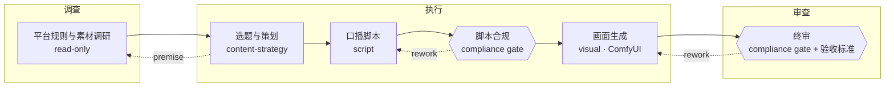

# 计划图与专家状态：最终方案（2026-09-29）

状态：方案已施工（P0–P6）。施工进展与未完事项见 [`plan-graph-and-expert-state-progress-2026-09-29.md`](plan-graph-and-expert-state-progress-2026-09-29.md)；本文保留为设计基准，历史段落不追改。取代同日草稿 `expert-as-state-2026-09-29.md`。
背景：[dynamic-experts-and-cognition.md](dynamic-experts-and-cognition.md) 的术语表与提交 `e34c28c`。

## 0. 前提：先计划，后行动

**Alpha 的每个任务都必须先有计划，才能行动。** 这是本方案其余部分的地基：没有计划就没有图，没有图就没有"当前在哪个节点"的状态。

这条规则目前没有落实。新任务默认"直接开始"（[new-task-draft.ts](../desktop/ui/src/state/new-task-draft.ts) 的 `startMode ?? "execute"`，[context.ts](../src/server/context.ts) 的 `startOptions`，[task-ledger.ts](../src/runtime/task-ledger.ts) 的 `phase: input.startMode ?? "execute"`），主代理提示词只建议"较大的开发工作使用 `alpha_plan`"（[session-profile.ts](../src/runtime/session-profile.ts)）。

落实方式是把两件事拆开：

| | 含义 | 是否强制 |
|---|---|---|
| **必须先有计划** | 记录下有效的计划图（第 3 节）之前，主代理只能调用规划类工具（[planning-policy.ts](../src/runtime/planning-policy.ts) 的只读工具加 `alpha_plan`），其余工具调用被拒绝并提示"先用 `alpha_plan` 记录计划" | 所有任务强制 |
| **必须等用户批准** | 计划记录后停下，等用户审阅 | 由启动开关决定 |

- 启动开关的含义随之改变："直接开始"改为**计划自动批准**，模型写完计划立即执行；"先规划后执行"保持为写完计划后等待审批。
- 拒绝发生在工具调用时，不在运行中途更换工具集，也不额外多跑一轮。
- 小任务的计划可以很薄，开销很小。
- 快速问答（会话角色 `answer`）不是任务，不受此约束。

## 1. 总览

**计划是这个任务的状态机拓扑，任务状态是指向它的游标。模型画图，运行时按图执行。**

通用编排框架（如 LangGraph）的图由开发者事先写定；Alpha 的图由模型在每次规划时画出，再由运行时强制执行、记录和验收。

分层结构：

```
任务状态（外层）   active / needs-input / stopped / complete
  └ 计划图          三阶段骨架 + 模型填入的节点 + 边
      └ 节点配置    专家状态 + 访问权限 + 执行位置
          └ 内核    常驻能力：核心 alpha_* 工具、浏览器、ComfyUI、专家目录搜索、用户显式勾选的能力
```

### 1.1 核心不变量

1. 没有有效计划，不能行动（第 0 节）。
2. 每次运行都属于且只属于一个节点；专家只在节点内被激活。
3. 节点状态由事件和产出推导，不由模型自报。
4. 专家只装载能力，不改变权限；权限由节点类型推导。
5. 最终验收不由主代理自审，由独立的 gate 完成。
6. 任务事件日志是唯一事实来源；以上一切都是事件的折叠结果。

### 1.2 术语

| 术语 | 含义 |
|---|---|
| 计划图 | 一个任务的节点与边的集合，由 `alpha_plan` 记录、按事件修订 |
| 阶段 | 骨架的三个宏观段：调查、执行、审查 |
| 节点 | 图中的一项工作，有类型（调查 / 执行 / 审查）、目标、依赖、专家决定、出口条件 |
| 游标 | 每个执行位置当前所在的节点；并行时为集合 |
| 执行位置 | 主会话（coordinator）或某个子代理（worker） |
| 专家状态 | 节点激活的专家：人设 + 随包 Skill + 声明的第三方 MCP |
| 访问权限 | `read-only` 或 `write`，由节点类型推导 |
| gate | 审查类节点：由指定角色独立审查，给出 `pass` / `changes-requested` / `inconclusive` |
| 交接 | 节点退出时记录的产物与说明，是下游节点唯一可见的上游内容 |

## 2. 现状与差距

1. **先计划未强制**（见第 0 节）。
2. **计划是图，但没接进状态机。** `CognitionStep` 已有 `dependsOn`（有向无环图）、状态、修订号，已派发或完成的步骤不可改写。但：
   - 没有游标，任务状态只知道 `plan` / `plan-review` / `execute` 三个大阶段；运行记录不标明在为哪一步工作。
   - 步骤状态由模型通过 `alpha_step` 自报；[apply/plan.ts](../src/runtime/task-events/apply/plan.ts) 只在"完成"时检查依赖，前置未完成也能标为进行中。
   - 返工（`development.repairAttempts`）、暂停、needs-context 在图外处理，暂停不记录停在哪个节点。
   - 任务状态、阶段、计划步骤、多个验收缺口是几套并行状态，彼此没有连起来。
3. **主代理能力池没有瘦身。** 未显式选择时加载全部已启用 Skill（[omp-runner.ts](../src/runtime/omp-runner.ts) 调 `loadSkills(undefined)`）；专家随包 Skill 被登记进全局能力目录（[capability-pool.ts](../src/runtime/capability-pool.ts)），主代理可以绕过专家直接取用。
4. **同一专家两种相反的激活语义、两套"指定专家"契约。** 派发类任务中专家绑定子代理、随包 Skill 不自动加载；非派发类任务中专家成为主代理人设、随包 Skill 自动加载（[task-profile.ts](../src/runtime/task-profile.ts) 的 `expertPerspective`）。
5. **"调查、执行、审查"三类子代理与专家冲突。** 名字像工种，实际混装了权限、知识和审查独立性三件事。
6. **内容任务无法接力。** 内容类任务 `dispatch: false`，专家只能作为主代理的单一人设。

## 3. 计划即图

### 3.1 结构

```ts
interface PlanNode {
  id: string;
  kind: "investigate" | "execute" | "review";
  phase: "investigate" | "execute" | "review";   // 所属阶段；审查类节点可出现在执行阶段内作中间检查
  objective: string;
  dependsOn: string[];
  expertDecision: { expertId?: string; temporaryExpert?: TemporaryExpert; reason: string }; // 必填，见 4.3
  host: "coordinator" | "worker";                // 执行位置
  consumes?: string[]; produces?: string[];       // 产物类型，见第 5 节
  ownedPaths?: string[];                          // 代码任务的可写范围
  gateRole?: string;                              // 仅审查类节点
}
interface PlanEdge { from: string; to: string; kind: "depends" | "rework" | "premise"; maxTraversals?: number }
```

`CognitionStep` 演进为 `PlanNode`：`mode` 改为 `kind`，其余字段沿用或新增。

### 3.2 三阶段骨架

调查、执行、审查几乎适用于任何工作，不同任务只是深度不同。因此：

- **骨架由运行时在任务创建时建好**，模型只能往三个阶段里填节点，不能删除阶段。
- **每个阶段至少一个节点**，`alpha_plan` 校验不通过时拒绝记录。
- **阶段顺序固定**：调查阶段全部完成，执行阶段的节点才能就绪；执行阶段全部完成，审查阶段的节点才能就绪。阶段内部的节点按 `dependsOn` 可并行。
- **规划期间可以完成调查节点**（沿用现有规则：规划阶段只能完成调查类步骤）。调查结论可用于细化尚未进入的执行节点。

深度可伸缩，每个阶段规定最低内容，由任务类型与 gate 决定下限：

| 阶段 | 最低内容 | 下限来源 |
|---|---|---|
| 调查 | 一条发现记录：已知什么、依据是什么、还缺什么 | 代码任务须记录读过的相关源码 |
| 执行 | 至少一个节点，并对由谁执行做出决定 | — |
| 审查 | 按验收标准核对运行时证据 | 任务类型默认 gate 与专家声明的 gate（第 6 节）要求独立审查 |

一个改一行字的任务，三个阶段各一个很薄的节点；一条要发到抖音的内容，审查阶段会被合规 gate 撑厚。

示例（短视频口播任务，节点名为角色而非具体专家）：



执行阶段中的 `R1` 是中间检查：在昂贵的画面生成之前先审脚本。

### 3.3 游标

- 每个执行位置有一个游标：主会话一个，每个子代理一个；并行时游标是集合。
- 每次运行记录 `nodeId`。主会话同一时刻只在一个节点上；子代理与其节点一一对应。
- "现在走到哪、在干什么"就是游标加上该节点当前运行的活动，界面直接展示。

### 3.4 节点生命周期

| 状态 | 进入条件（由事件推导） |
|---|---|
| `planned` | 计划中已有 |
| `ready` | 所有 `depends` 前置节点为 `done`，且所属阶段已开放 |
| `active` | 游标进入（`node/entered`） |
| `waiting` | 在该节点上暂停：等用户回答、等审批、等其他节点回复（`node/waiting`，带现有暂停码） |
| `done` | 满足出口条件（`node/exited`） |
| `reopened` | 沿回边退回（`node/reopened`），随后可再次进入 |
| `cancelled` | 计划修订中取消（仅限未进入的节点） |

出口条件按节点类型定义，由运行时校验：

| 类型 | 出口条件 |
|---|---|
| 调查 | 发现记录，每条带依据（文件片段、网页来源或用户素材） |
| 执行 | 交接记录：`produces` 声明的产物均存在并记录哈希；代码节点另需工单结果被集成 |
| 审查 | gate 结论，引用产物或源码原文，绑定契约版本与产物哈希（或源码版本） |

`alpha_step` 由"改状态"改为"退出节点"：必须提交出口所需的产物，状态由运行时判定，不再接受模型直接写 `complete`。

### 3.5 回边与暂停

- **`rework`：审查退回执行。** 审查给出 `changes-requested` 时，重新打开被审查的执行节点；修改意见作为输入。自动次数上限为 2（沿用现有"修复优先交回原执行者、最多自动两轮"），超过后暂停等待用户。
- **`premise`：退回调查。** 执行或审查发现前提有误时，重新打开相应调查节点（沿用现有 needs-context 语义）。下游已完成节点若所用输入的哈希发生变化，标记为过期，由主代理决定重做还是保留。
- **暂停挂在节点上。** `waiting` 记录节点与暂停码；恢复后游标回到同一节点。

### 3.6 节点决定会话配置

游标所在的节点决定这一轮会话的专家状态、访问权限和工具集：

- **切换节点即运行边界。** 主会话进入新节点时，本轮以停止原因 `node-switch` 结束，驱动循环立即续跑并按新节点重建会话。这复用"协调轮预算到期记录状态并续跑"的现有路径，也符合"运行中途不换工具"的原则。
- **配置相同则不重建。** 相邻节点的专家和访问权限都相同时，游标只移动，不结束本轮，避免小任务多跑几轮。

### 3.7 修订

- 只能修改或取消**尚未进入**的节点，已进入、已完成的节点不可改写（沿用现有规则）；骨架的三个阶段不可删除。
- 自动批准模式下修订立即生效；审批模式下，修订涉及的节点需要用户重新批准，其余节点照常推进。
- 每次修订写 `plan/revised`，带理由与受影响节点（沿用现有 `amendments`）。

### 3.8 现有状态成为图的投影

- `phase`：计划未批准为 `plan` / `plan-review`；游标在图中为 `execute`。
- 验收缺口：`plan-steps`、`development-review`、`designated-expert` 与新的 gate 缺口统一改为从图推导：`plan-graph`（有节点未完成）与 `gate`（有 gate 未通过或已过期）。验收标准与证据（`criteria` / `evidence`）保持独立，由审查节点核对。
- 任务可完成，当且仅当：图中所有未取消节点为 `done`、所有 gate 通过且未过期、验收证据满足。

## 4. 节点里装什么：专家即状态

**专家不是一个 Skill，也不是一个插件，而是节点状态的一部分。** 进入节点时激活其专家，装载人设、随包 Skill 和声明的第三方 MCP；离开节点时全部卸载，只留下产物和交接记录。专家可以在主会话里激活，也可以在子代理里激活，语义完全相同。

### 4.1 激活规则

- 同一执行位置同一时刻最多一个激活专家。多个专家并行用多个子代理；多个专家先后工作用接力。
- 专家激活不是独立事件，而是 `node/entered` 的一部分（记录专家 ID、内容哈希与装载快照）。
- 专家状态只装载能力；访问权限、逐项授权、沙盒和预算由运行时决定，专家文本和随包 Skill 都不能增加权限。

### 4.2 内核与主池瘦身

- **内核常驻**：核心 `alpha_*` 工具、浏览器、ComfyUI 生成、专家目录搜索，以及用户在本任务显式勾选的能力。浏览器与 ComfyUI 足够通用，作为内置能力，不由专家声明。
- **不再默认加载全部 Skill**：主代理未显式选择时 Skill 列表为空；独立安装的 Skill 通过 `alpha_capability_search` 与 `alpha_skill_read` 按需读取。
- **专家随包 Skill 移出全局能力目录**：主代理只能搜索专家，不能越过专家取用其 Skill。

### 4.3 谁决定节点里用哪个专家

每个节点的 `expertDecision` 必填，三种取值：

1. **主代理自己做**：不激活专家，写明理由。
2. **使用已有专家**：指定专家 ID。
3. **临时专家**：模型为本任务组合一个临时专家（人设 + 已安装的 Skill），只在本任务有效，不能增加权限；要存入专家库须经用户批准，流程与现有 Skill 提案一致。

决定的来源按优先级：

| 来源 | 方式 | 确定性 |
|---|---|---|
| 用户显式指定 | 专家选择器（`designatedExpertId`），成为图的约束：至少一个节点使用该专家并完成 | 确定；模型不能改写 |
| 已批准的计划 | 节点进入时，运行时按 `expertDecision` 激活 | 确定；不经过模型临时判断 |
| 计划修订 | 需要新专家时，先修订计划增加或修改未进入的节点，再进入 | 由模型判断，记录理由 |

图之外不存在专家激活；"临时想用某个专家"就是一次计划修订。

候选质量同步提高：`initialExpertCandidates` 在名称与描述打分之外，叠加角色、`produces` / `consumes` 匹配和沿 `next` / `gate` 的一跳扩展。

### 4.4 装载内容

统一入口 `resolveExpertScope(expert, host, access)`，主会话与子代理共用：

1. 人设注入提示词。
2. 主方法（`primarySkill`）的 `SKILL.md` 正文直接注入，不再要求模型先调用 `alpha_skill_read`；超出 [prompt-budget.ts](../src/runtime/prompt-budget.ts) 预算时退回为只列条目、按需读取，并在运行记录中标注。
3. 其余随包 Skill 列入会话 Skill 列表，按需读取。
4. 声明的 MCP 按现有逐项授权打开；不可用时暂停并上报缺口，不静默跳过。
5. Skill 的 `requires-tools` / `requires-services` / `conflicts-with` 按访问权限校验（沿用 `validateSkillBindings`）。
6. 节点显式追加的 Skill 与能力合并装载，来源分别记录。

这推翻 `e34c28c` 中"随包 Skill 是推荐组合、从不隐式加载"的约定：随包 Skill 是专家状态的一部分，激活即加载；显式选择只用于追加。

## 5. 专家声明

专家声明包括**装载**与**交接**两部分：

```yaml
mounts:
  skills: [alpha-core:create-content]      # 随包 Skill，激活即加载
  primarySkill: alpha-core:create-content  # 正文直接注入的主方法
  mcp: []                                  # 需要的第三方 MCP 服务
handoff:
  role: content-strategy                   # 本专家的角色标签
  consumes: [brief, source-material]       # 需要的输入产物类型
  produces: [topic-plan, script, visual-brief]
  next: [script, visual, platform-ops]     # 通常交给哪类角色（软关系）
  gate: [compliance]                       # 本专家产物交付前必须经过的角色（硬关系）
```

- **按角色和产物类型声明，不写对方专家 ID。** 专家库由用户挑选、导入和停用，写死 ID 会重新引入耦合，被引用专家一变关系即断，维护量还会随专家数成倍增长。
- **软关系用于规划，硬关系用于验收。** `consumes` / `produces` / `next` 用于扩展候选和检查计划断链（相邻节点 `produces` 与 `consumes` 无交集时提示，不拒绝）；`gate` 由运行时转成审查类节点的要求。
- **`gate` 由产出方声明。** 产出方知道自己的产物要对外发布；合规专家不需要知道谁依赖它。
- **一份声明，两处使用。** 人设正文的"交接边界"段由声明生成，不再手写两份。
- **存放位置。** 内置专家写在 [presets/agents/index.json](../presets/agents/index.json) 的注册条目（现有 `skill` 字段映射为 `primarySkill`）；导入与自建专家写在专家包清单（`ExpertPackage` 增加 `mounts` 与 `handoff`）。声明计入专家内容哈希，改动即生成新版本；已进入的节点保留旧快照。
- **角色词表。** 角色与产物类型使用受控词表 `presets/agents/roles.json`，内置专家只能引用词表中的值（测试校验）；自建专家可用词表外的值，界面提示但不拒绝。
- **兼容。** 没有 `handoff` 的旧专家仍可使用，只是不参与断链检查、不声明 gate。

## 6. 接力与 gate

### 6.1 接力

接力就是执行阶段内节点之间的 `depends` 边，由主代理在计划中排定，专家声明只提供建议与约束，不自动触发下一棒。

**交接只传产物，不传对话。** 节点退出时的 `node/exited` 就是交接记录：

```ts
{
  nodeId: string; runId: string;
  expert?: { id: string; hash: string };
  artifacts: Array<{ path: string; hash: string; kind: string }>; // kind 取自 produces
  findings?: Array<{ claim: string; source: string }>;             // 调查节点
  verdict?: "pass" | "changes-requested" | "inconclusive";       // 审查节点
  note: string;         // 做了什么、哪些待核验、下游需注意什么
  unresolved: string[]; // 未解决事项，下游必须看到
  contractVersion: number;
}
```

下游节点的会话只拿到：任务目标、计划图、上游节点的交接记录与产物。上游的 Skill、MCP 和对话都不带过去。下游对上游有疑问时，通过主代理消息箱提出，主代理决定回复、补充上下文，或沿 `premise` / `rework` 边重开上游节点。

### 6.2 gate：审查的独立性

主代理继续做**集成检查**（逐个决定合并或拒绝子代理结果，现有 `integrationDecision`），但**最终验收不由主代理自审**：它做了计划、派了工、做了集成，自审倾向于放行，而且上下文里全是过程信息。

审查类节点满足三条：

1. **角色**：由 `gateRole` 指定的角色承担，如 `code-review`、`compliance`。
2. **独立**：与被审查的产出不是同一次节点进入；会话上下文只含任务目标、验收要求、产物（或源码版本）和交接记录。
3. **版本绑定**：结论引用产物或源码原文，绑定契约版本与产物哈希（或源码版本）；任一变化即过期，需重新审查（沿用现有开发审查规则）。

独立性来自**上下文隔离**，不一定需要子代理：

- **内容任务**：审查节点在主会话中进入即可。会话在运行边界重建，只拿到产物和交接记录，本身就是干净的上下文。
- **代码任务**：最终审查仍在子代理中执行，因为需要在沙盒里跑检查、引用 worktree 中的源码原文。

gate 的来源与承担者：

- **任务类型默认 gate**：`TaskProfile.developmentReview` 改为 `defaultGates`；`code-change` 与 `web-product` 默认 `code-review`，其余类型为空。现有开发审查即这一默认 gate，`runDevelopmentWorkflow` 的最终审查改为进入一个 `code-review` 审查节点。
- **专家声明的 gate**：产出方专家声明的 `gate` 角色，要求其产物在交付前有对应审查节点通过。
- **承担者**：`code-review` 有匹配专家时优先使用，否则由内置中性审查者承担（保持现状）；`compliance` 等需要专业知识的 gate 没有中性兜底，缺少满足该角色的已启用专家时记为能力缺口并暂停，不静默放行。

### 6.3 "指定专家"契约统一

用户指定专家统一为图的约束：**图中至少有一个使用该专家的节点，且该节点在当前契约版本下为 `done`**。派发类与非派发类任务不再各有一套契约；`expertPerspective` 由节点的 `host` 取代。

## 7. 访问权限

原先的"调查、执行、审查"三类子代理，在本方案中变成**节点类型**，它们混装的三件事各归其位：知识归专家（第 4 节），审查独立性归 gate（第 6.2 节），权限归运行时，只保留两档：

| 访问权限 | 含义 | 适用节点 |
|---|---|---|
| `read-only` | 可读源码、产物和网页；可在沙盒临时副本上跑已配置检查；不能写源码或产物 | 调查、审查 |
| `write` | 可写本节点声明的范围：代码任务为 `ownedPaths`，内容任务为本任务的交付目录 | 执行 |

- 权限由节点类型推导，不由模型选择；审查节点强制 `read-only`。
- 内核能力按权限提供：`write` 可用 ComfyUI 生成；`read-only` 不提供生成类工具；浏览器保持现状（所有实例可用，经主侧适配器串行转发）。
- 调查不必派子代理：轻量调查由主代理在调查节点中直接完成；需要大量阅读、避免占满主代理上下文或需要并行时，调查节点的 `host` 设为 `worker`，可不带专家，也可带调研类专家。
- 兼容：历史事件与工单中的 `investigate` / `review` 折叠为 `read-only`，`implement` 折叠为 `write`；历史 `review` 实例折叠为一次 `code-review` gate 结论。`alpha_spawn` 过渡期内接受旧取值并映射。

## 8. 事件

新增事件，沿用现有"名词/动词"命名，加入 `task-events/types.ts` 并实现折叠：

| 事件 | 载荷要点 |
|---|---|
| `graph/skeleton-created` | 三个阶段 |
| `plan/revised`（现有，扩展） | 节点与边；受影响节点；理由 |
| `node/entered` | `nodeId`、执行位置、`runId`、专家快照、访问权限 |
| `node/waiting` | `nodeId`、暂停码 |
| `node/exited` | 交接记录（第 6.1 节） |
| `node/reopened` | `nodeId`、边类型（`rework` / `premise`）、来源节点、理由 |

停止原因新增 `node-switch`。旧任务没有这些事件时，按"单节点图"读取：已有 `steps` 映射为执行阶段节点，已有 `instances[].expert` 映射为节点进入记录，保证历史可读。

## 9. 与现有机制的对应

| 现有 | 改为 |
|---|---|
| 启动默认"直接开始" | 必须先有计划；"直接开始"即计划自动批准 |
| `CognitionStep` 看板 | `PlanNode` 图 + 三阶段骨架 + 游标 |
| `alpha_step` 自报状态 | 退出节点，提交出口产物，状态由运行时判定 |
| `step/changed` 只在完成时查依赖 | 进入前须 `ready` |
| `development.repairAttempts`、needs-context | `rework` / `premise` 回边 |
| `TaskPhase` 与多个验收缺口 | 图的投影：`plan-graph`、`gate` |
| 协调者默认加载全部 Skill | 内核 + 显式勾选；独立 Skill 按需读取 |
| 能力目录中的 `expert-<id>:s<hash>` | 移除 |
| omp-runner 的 `directExpert` 分支 | 主会话节点激活，走 `resolveExpertScope` |
| `bindWorkOrders` 中"Skill 只认显式选择" | 子代理节点激活：随包 Skill ∪ 显式追加 |
| `TaskProfile.expertPerspective` | 节点 `host` |
| `designated-expert` 两套契约 | 图约束：该专家的节点完成 |
| `ExecutionMode = investigate \| implement \| review` | 节点类型 + `AccessLevel = read-only \| write` |
| 审查模式子代理 | 审查类节点（gate） |
| `TaskProfile.developmentReview` | `TaskProfile.defaultGates` |
| 人设中"先读取随包方法 `alpha-core:<skill>`" | 删除；主方法激活时注入 |
| 人设中的散文交接 | 由 `handoff` 声明生成 |

## 10. 实施步骤

每步可独立合并。规模为粗估：S 约半天，M 约一到两天，L 约两到三天。

### P0 量化基线（S）

- 用 `scripts/probe-session-prompt.ts` 与 `scripts/probe-capability-pool.ts` 记录主代理当前加载的 Skill 数、MCP 数与提示词 token；用现有评测记录一条小任务、一条代码任务、一条内容任务的运行次数与 token。写入本文档附录，作为后续对比基线。

### P1 先计划与主池瘦身（M）

- 规划前工具守卫：未记录有效计划时，只允许规划类工具。
- 启动开关语义改为"计划自动批准 / 等待审批"，界面文案同步。
- 协调者未显式选择时 Skill 列表为空；能力目录移除专家随包 Skill；`resolvePoolSkill` 的 `expert-` 分支只对当前节点的激活专家开放。
- 测试：无计划时非规划工具被拒绝；自动批准模式不暂停；目录中无 `expert-` 条目。

### P2 专家激活即装载（M）

- 新增 `src/runtime/expert-scope.ts`，实现第 4.4 节六步；`ExpertPackage` 增加 `mounts`，`index.json` 的 `skill` 映射为 `primarySkill`。
- omp-runner 的 `directExpert` 分支与 `bindWorkOrders` 的 Skill 计算都改为调用 `resolveExpertScope()`。
- 通过 `scripts/sync-core-experts.ts` 批量删除内置人设中"先读取随包方法"一句。
- 测试：更新 `e34c28c` 中固定"从不隐式加载"的三个测试；新增预算超限退回列表模式的测试。

### P3 计划图：骨架、游标、生命周期、权限（L）

- `CognitionStep` 演进为 `PlanNode`；任务创建时写 `graph/skeleton-created`；`alpha_plan` 校验三阶段均有节点、`expertDecision` 必填。
- 事件 `node/entered`、`node/waiting`、`node/exited` 及折叠；运行记录 `nodeId`；停止原因 `node-switch` 与"配置相同不重建"。
- 生命周期按第 3.4 节推导；`alpha_step` 改为退出节点；进入前校验 `ready`。
- `AccessLevel` 两档，由节点类型推导；沙盒、工单、`alpha_spawn` / `alpha_continue` 改用它。
- 旧任务按单节点图读取。
- 测试：阶段顺序与依赖守卫；出口条件缺失时不能退回 `done`；暂停后恢复回到同一节点；审查节点无法获得 `write`；历史任务折叠。

### P4 回边、修订与投影（L）

- `rework` / `premise` 回边与次数上限；`node/reopened`；下游节点按输入哈希标记过期。
- 修订规则按第 3.7 节；审批模式下只对受影响节点要求重新批准。
- `phase` 与验收缺口改为图的投影（`plan-graph`、`gate`）；"指定专家"改为图约束。
- 测试：两轮自动返工后暂停；前提回退使下游过期；修订不能改写已进入节点；两类任务的指定专家契约一致。

### P5 专家声明、接力与 gate（L）

- `presets/agents/roles.json`；为内容线专家补 `handoff`（策划、写作、各平台运营、合规、增长分析）；人设"交接边界"段由声明生成。
- 交接记录与下游上下文组装（只含目标、图、上游交接与产物）。
- 审查类节点的独立性校验与版本绑定；`defaultGates` 取代 `developmentReview`，`runDevelopmentWorkflow` 的最终审查改为进入 `code-review` 节点。
- `initialExpertCandidates` 叠加角色与产物匹配、一跳扩展；临时专家的创建与"存入专家库"审批。
- 测试：`test/agent-presets.test.ts` 校验内置专家只引用词表角色、每个被 `gate` 或 `next` 引用的角色至少有一个内置专家承担；gate 未通过时任务不能完成；产物变化后 gate 过期；`compliance` 无专家时暂停、`code-review` 无专家时由中性审查者承担；原开发审查测试迁移后全部通过。

### P6 界面与端到端评测（L）

- 界面以图展示计划：阶段、节点、边、游标高亮、每个节点的专家、交接产物与 gate 结论；暂停时标出停在哪个节点。
- 端到端评测：
  - 内容任务："调研 → 选题 → 脚本 → 脚本合规 → 画面 → 终审"，含一次 `changes-requested` 返工；
  - 代码任务：沿用现有评测中较难的代码任务与多轮暂停场景；
  - 小任务开销：改一行字的任务，与 P0 基线对比运行次数与 token；
  - 中途改计划：执行中发现前提有误，沿 `premise` 回退并修订未进入的节点。

每步完成后按 AGENTS.md 第 6 节运行 `quick_validate.py`、`bun test ./test/agent-presets.test.ts` 与 `bun run check`。

## 11. 需同步修改的规范与文档

- **AGENTS.md 第 3 节**：删除"人设中统一声明：先读取随包方法 `alpha-core:<skill>`"；人设四件事中的"交接边界"改为由 `handoff` 声明生成；Skill 编写要求补充 `mounts` 字段。按 AGENTS.md 的约定在文中留痕。
- **[dynamic-experts-and-cognition.md](dynamic-experts-and-cognition.md)**：术语表与派发章节按本方案更新；历史段落保留原意。
- **内置人设**：经 `scripts/sync-core-experts.ts` 批量更新。
- **界面文案**："直接开始"改为"自动批准计划"，并说明两种模式都会先规划。

## 12. 不做的事

- 不在运行中途热插拔工具或切换人设；切换只发生在运行边界。
- 不为内容任务建第二套子代理设施；worktree、Git 锚点、hashline 仍只服务代码任务。
- 不让专家声明自动触发下一棒；调度权只在主代理，且必须体现在计划图中。
- 不让专家声明或随包 Skill 改变权限。
- 不让主代理自审最终验收。
- 不保留"调查、执行、审查"三类子代理类型；它们只作为节点类型存在。
- 不在图之外激活专家。

### 13. 验证与成功标准

- **主池**：P1 后主代理提示词 token 与 Skill 数相对 P0 基线的变化。目标值（P0 实测后填写）：未显式选择时 Skill 数 2 → **0**；能力目录专家随包条目 111 → **0**；主代理固定提示词 token（系统 + 工具）**不高于基线**（skillLines 消失后应下降）。
- **小任务开销**：三阶段骨架与先计划带来的额外运行次数与 token，相对 P0 基线的增量。目标值（P0 实测后填写）：改一行字任务**运行次数 ≤ 4 轮**（P0 小任务 1 轮），总 token **≤ 2 × 基线**（约 6 万 tokens）。P6 评测后按实测数据校准这两个目标。
- **接力质量**：内容评测中 gate 拦下的问题数、返工轮数，与"主代理单一人设"方式对比。
- **可追溯**：任意时刻能从事件日志回答"在哪个节点、由哪个专家、用什么权限、基于哪些上游产物"。

## 14. 待定问题

1. 角色词表首批范围：建议先覆盖内容线与合规，开发、研究、游戏线在 P5 之后按需补充。
2. 用户自建专家使用词表外角色时，能否作为 gate 满足验收：建议允许，但在界面上标注"非内置角色"。
3. 节点粒度指引：规划提示中给出多粗的建议，待 P6 评测后按开销数据确定。
4. 前提回退导致下游过期时，是自动重开还是由主代理逐个决定：建议先由主代理决定，积累数据后再考虑自动化。

## 附录 A：P0 量化基线（2026-09-29 实测）

### A.0 P6 评测环境变更（2026-09-29 实测记录）

P6 端到端评测开始时，默认模型 `xiaomi-token-plan-cn/mimo-v2.6-flash`（P0 基线所用）已严重限速：同一探针从 P0 的秒级变为 **84.75s**（`bun run probe:model`，一次 ALPHA_OK），超过运行时 45s 无响应上限，5 个任务全部以 `stop.reason=model` 停止、0 次工具调用。对照：`xiaomi-token-plan-cn/mimo-v2.6-pro` 2.9s、`deepseek/deepseek-flash` 0.7s。

因此 P6 各轮改换模型：先换 `xiaomi-token-plan-cn/mimo-v2.6-pro`（2.9s，同 provider），后按用户指示改用 **`deepseek/deepseek-flash`**（0.7s）——xiaomi 系额度即将耗尽，不宜承担多任务长跑。评测命令显式带上 `--model deepseek/deepseek-flash`。**P6 与 P0 的轮次/token 对比因此带有模型差异**，小任务增量只作量级参考，不作严格同模型对比。加 `--model` 的评测入口与探针的 `PROBE_MODEL` 环境变量已入库。

失败的整轮记录保留在 `artifacts/eval-2026-09-29-p6-round-1-provider-down/`；xiaomi pro 的半程记录保留在 `artifacts/eval-2026-09-29-p6-round-1-xiaomi-partial/`（换模型后重跑，不计入对比）。

P0 交付。方法与原始数据：

| 数据 | 来源 | 原始输出 |
|---|---|---|
| 主代理能力池与提示词 | `bun run scripts/probe-session-prompt.ts` | `artifacts/probe-session-prompt-p0-baseline.log` |
| 能力分发链路 | `bun run scripts/probe-capability-pool.ts` | `artifacts/probe-capability-pool-p0-baseline.log` |
| 任务运行次数与 token | 现有评测记录 | `artifacts/eval-2026-09-29-p6-round-2/`、`artifacts/eval-2026-09-29-p6-round-3/`（10 任务全量） |

### A.1 主代理能力池与提示词（改造前）

- **默认能力装载**（任务未显式选择时 `loadSkills(undefined)`）：**2 个 Skill**（`cocoindex-code:ccc`、`mineru-local:mineru-document-extractor`）、**1 个 MCP 服务**（`alpha_cocoindex-code_cocoindex-code`）、0 个 MCP 工具。
- **能力目录**：共 119 条 —— skill 113 条（其中 **111 条为专家随包 `expert-` 条目**）、mcp-server 1 条、builtin-tool 5 条；启用 22 条。P1 之后专家随包条目应为 0。
- **固定提示词 token**（`promptFootprint`，模型 `xiaomi-token-plan-cn/mimo-v2.6-flash`，tokenizer 估算 `exact=false`）：

| 会话角色 | 系统提示词 | 工具定义 | 工具数 | 备注 |
|---|---|---|---|---|
| coordinator（code-change） | 3,717 | 2,726 | 5 | 探针受限工具集（read/grep/ast_grep/edit/write）；完整工具表见评测记录 |
| answer | 2,842 | 1,174 | 3 | 同上 |

评测记录中的完整工具表口径：代码任务 4,944–5,071 + 4,741（37 工具），通用任务 4,634–4,742 + 3,567（35 工具）。

### A.2 能力分发链路（改造前）

`probe-capability-pool` 全链路成功：worker 上报能力缺口 → 主代理 `alpha_capability_search` 检索并 `alpha_worker_resolve` 授予 `sample:proof` 快照 → 续跑 worker 完成修改、`alpha_check` 通过、`alpha_integrate` 合并。主代理该场景工具序列：`alpha_capability_search`、`alpha_inbox`、`alpha_worker_resolve`、`alpha_inspect`、`alpha_integrate` ×2。协调轮固定提示词 4,173 + 4,491 与 4,122 + 4,491（33 工具），4 轮共 379,054 tokens（worker 2 轮 233,173 + 协调 2 轮 145,881）。

### A.3 任务运行次数与 token（改造前）

来自 2026-09-29 两轮全量评测（每轮 10 任务，本方案施工前的最后一个稳定状态）。代表任务的运行次数与 token：

| 类别 | 任务 | round-2 | round-3 | 固定提示词 |
|---|---|---|---|---|
| 小任务 | `sales-question` | 1 轮 / 1 调用 / 28,946 tok | 1 轮 / 1 调用 / 29,586 tok | 4,742 + 3,567 |
| 代码任务 | `lru-cache` | 3 轮 / 22 调用 / 405,380 tok | 5 轮 / 58 调用 / 2,044,815 tok | 4,970 + 4,741 |
| 内容任务 | `product-copy` | 1 轮 / 0 调用 / 14,691 tok | 1 轮 / 0 调用 / 13,602 tok | 4,634 + 3,567 |
| 多轮暂停（P6 沿用） | `approval-loop` | 4 轮 / 32 调用 / 460,805 tok（1 次恢复） | 4 轮 / 43 调用 / 580,572 tok | 4,948 + 4,741 |

说明：代码任务的轮次与 token 有较大波动（`lru-cache` 3–5 轮、40–200 万 tokens），小任务与内容任务稳定（各 1 轮）。P6 对比时以轮次为主、token 为辅，并至少跑两轮取区间。小任务基线选用 `sales-question`（现有评测中最接近"改一行字"开销的任务）；`lru-cache` 同时是 P6 要沿用的较难代码任务，两处口径一致。
